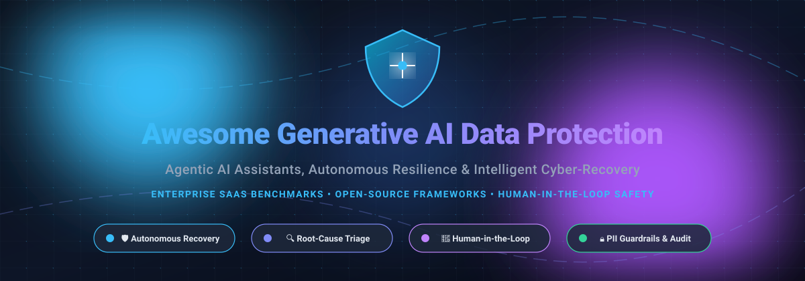
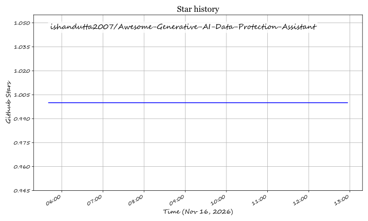

  

# 🛡️ Awesome Generative AI Data Protection Assistant 🤖

  
  
  
  
  
  

---

## 📖 Introduction & Ecosystem Scope 🌐

A curated directory and reference architecture guide of **Enterprise SaaS Platforms** and **Open-Source GitHub Projects** powering **Generative AI Data Protection Assistants**, autonomous backup operations, agentic cyber-resilience, and human-supervised recovery workflows. 

Modern enterprise backup and disaster recovery (BDR) infrastructure is transitioning from rigid scripted runbooks to conversational and agentic intelligence. These AI assistants help backup administrators, SREs, and security operations center (SOC) teams use natural language to triage job failures, compute surgical recovery point objectives (RPO/RTO), automate air-gapped recovery sequences, and preserve data sovereignty.

---

## 📊 Sector Overview & Market Dynamics 📈

The global **Data Protection and Cyber Resilience market** is estimated at **$10.1 Billion in 2026** (scaling within the broader $199B+ data security and privacy sector), driven by double-digit compounding growth as enterprises confront ransomware targeting backup repositories and unmanaged AI data pipelines. The sector is **moderately fragmented**: mega-cap hyper-scalers (Microsoft) and established cybersecurity titans (Palo Alto Networks, CrowdStrike) command broad endpoint and identity telemetry, while specialized enterprise cyber-resilience leaders (Rubrik, Veeam, Commvault) aggressively contest winner-takes-all platform consolidation for immutable data recovery.

---

## 📑 Table of Contents 🧭

- [📊 Sector Overview & Market Dynamics](#-sector-overview--market-dynamics-)
- [☁️ SaaS / Hosted Platforms](#️-saas--hosted-platforms)
- [💻 Open-Source GitHub Projects](#-open-source-github-projects)
- [🤝 How to Contribute](#-how-to-contribute)
- [⚠️ Security & Governance Disclaimer](#️-security--governance-disclaimer)
- [📈 Star History](#-star-history)
- [☕ Support & Sponsorship](#-support--sponsorship)

---

## ☁️ SaaS / Hosted Platforms

Below are the leading commercial platforms delivering embedded generative assistants and autonomous agents for cyber-resilience and backup operations. 

> *Table sorted descending by **Company Scale (Market Capitalization / Enterprise Valuation)**.*

| Product | Company Scale (Valuation / Market Cap) | Description | Pricing (Starting Tier) | Free Tier / Trial Limits |
|:---|:---|:---|:---|:---|
| **[Microsoft Security Copilot in Purview](https://learn.microsoft.com/en-us/purview/copilot-in-purview-overview)** | **~$3.89 Trillion** (Market Cap) | **Embedded and standalone AI assistant across Microsoft Purview.** Summarizes and triages Data Loss Prevention (DLP) alerts, Insider Risk Management, Communication Compliance policy matches, and eDiscovery cases via natural language promptbooks. | **$4.00 per SCU/hour** (~$2,880/month for 1 provisioned Security Compute Unit); or included grant of 400 SCUs/mo per 1,000 Microsoft 365 E5/E7 seats | **No free tier**; 30-day proof of concept / trial available through Microsoft Enterprise Agreement account teams |
| **[Palo Alto Cortex Agentic Agents](https://live.paloaltonetworks.com/)** | **~$263 Billion** (Market Cap) | **Autonomous agentic investigation and remediation for XDR and XSIAM.** Replaces legacy Cortex Copilot with autonomous agents that plan, coordinate, and execute threat containment across networks, cloud storage, and endpoints under admin policy guardrails. | **$70.00 per endpoint/year** list for Cortex XDR Pro (with agentic agents included at no additional add-on fee as of 2026) | **30-day free trial** of Cortex XDR / XSIAM virtual lab with full agentic feature access via authorized sales partners |
| **[CrowdStrike Charlotte AI](https://www.crowdstrike.com/)** | **~$232 Billion** (Market Cap) | **Agentic AI SOC teammate for the Falcon ecosystem.** Dispatches specialized agents across endpoints, cloud backups, and identity workloads. Features AgentWorks no-code workflows and Agentic SOAR with ISO 42001 certification and complete evidence auditability. | **£16.00 (~$20.50) per endpoint/year** add-on under public sector cloud agreements (requires underlying Falcon platform starting ~$180/endpoint/yr) | **15-day complimentary trial** with pre-allocated Charlotte AI credit pack for existing Falcon Enterprise customers |
| **[Rubrik Ruby](https://www.rubrik.com/)** | **~$22.8 Billion** (Market Cap) | **Pioneering agentic cyber-recovery teammate for Rubrik Security Cloud (RSC).** Automatically runs root-cause analysis on backup failures, calculates blast radius after ransomware attacks, generates compliance reports, and orchestrates surgical recovery runbooks under human approval. | **$2.63 per user/month** for M365 SaaS backup; Core infrastructure capacity licensing starts at **~$150.00 to $160.00 per TB protected/year** | **30-day guided enterprise proof of concept (PoC)** with access to Ruby advisory mode via Rubrik sales engineering |
| **[Veeam Intelligence](https://www.veeam.com/)** | **~$15.0 Billion** (Valuation) | **AI conversational assistant built into Veeam Data Cloud.** Trained on deep Veeam architecture and recovery documentation. Resolves backup errors, generates recovery scripts, and validates repository health in multi-tenant environments. | **$1.08 per user/month** for Entra ID backup; **$3.33 per user/month** (billed annually) for Veeam Data Cloud M365 Advanced | **30-day free trial** of Veeam Data Cloud (protects up to 10 users with full Veeam Intelligence access; standard query throttle applies: 200 queries/day) |
| **[SentinelOne Purple AI](https://www.sentinelone.com/)** | **~$7.7 Billion** (Market Cap) | **Zero-click agentic investigation and response engine.** Uses multi-model reasoning (Claude, GPT, and Ultraviolet) to autonomously detect data tampering, audit snapshot integrity, and orchestrate rollback mitigation with verifiable cryptographic evidence. | **$179.99 per endpoint/year** (bundled into Singularity Complete tier with baseline Purple AI capability) | **30-day free trial** of Singularity Platform with a complimentary starter bundle of Singularity AI credits |
| **[Commvault Arlie](https://www.commvault.com/)** | **~$6.7 Billion** (Market Cap) | **Generative AI assistant embedded across Commvault Cloud.** Powers Arlie Data Sense for proactive ransomware anomaly alerts, automated log parsing for failure root-cause extraction, and Video Bytes timestamped technical guidance. | **$58.50 per TB/month** for Cloud File & Object Backup; **$1.70 per user/month** for Microsoft 365 SaaS protection | **30-day unlimited free trial** of Commvault Cloud SaaS backup with full interactive Arlie assistance |

---

## 💻 Open-Source GitHub Projects

Self-hosted resilience frameworks, open-source AI guardrails, and automated backup engines for developers requiring complete data sovereignty, zero LLM telemetry exfiltration, and human-in-the-loop validation.

> *Table sorted descending by **GitHub_Stars**.*

| Project | GitHub_Stars | Focus & Description |
|:---|:---|:---|
| **[Wazuh](https://github.com/wazuh/wazuh)** |  | **Unified SIEM and XDR Security Engine.** Open-source platform providing file integrity monitoring (FIM), anomaly detection, root-cause compliance reporting, and automated response hooks to guard backup repositories and enterprise servers against ransomware attacks. |
| **[Presidio](https://github.com/data-privacy-stack/presidio)** |  | **Data Protection & PII Anonymization Layer for AI.** Industry-standard contextual engine for recognizing, anonymizing, and redacting Personally Identifiable Information (PII) before feeding unstructured backup logs or user records into generative AI models. |
| **[Velero](https://github.com/velero-io/velero)** |  | **Kubernetes Disaster Recovery & Volume Protection.** The leading cloud-native backup and migration tool for Kubernetes clusters. Safely snapshots persistent volumes and restores container states during catastrophic outages. |
| **[OpenCTI](https://github.com/OpenCTI-Platform/opencti)** |  | **Open Cyber Threat Intelligence Platform.** Knowledge graph platform structuring cyber threats and threat-actor campaigns. Frequently integrated with LLM query layers to provide contextual risk scoring for backup repositories and network perimeters. |
| **[Guardrails AI](https://github.com/guardrails-ai/guardrails)** |  | **Validation Framework & Guardrails for LLM Agents.** Enforces strict structural, semantic, and security constraints on generative AI agents. Ensures data resilience assistants do not generate hallucinatory or destructive operational commands without validation. |
| **[Rebuff](https://github.com/protectai/rebuff)** |  | **Prompt Injection Detector for AI Agents.** Multi-layered defense framework designed to detect prompt injection attacks before they can hijack autonomous data protection agents or trigger unauthorized disaster recovery runs. |
| **[Anybackup](https://github.com/anybackup-ai/Anybackup)** |  | **AI-Native Data Resilience Platform (Alpha).** Natural-language backup and recovery planning engine with strict human confirmation workflows. AI formulates structured plans and risk assessments, requiring explicit operator approval before executing storage modifications. |
| **[Agent Settings Backup Script](https://github.com/Dicklesworthstone/agent_settings_backup_script)** |  | **Specialized Git-Versioned Backup for AI Agents.** Automates isolated, credential-safe backups and version tracking for AI coding agents, IDE states, memory caches, and agent runtime configurations. |

---

## 🤝 How to Contribute 🛠️

We welcome contributions from the data protection, DevOps, and AI engineering communities!

1. 🍴 **Fork** the repository.
2. 🌿 Create a new feature branch (`git checkout -b feature/new-ai-assistant`).
3. 📝 Add or update entries in `README.md` following our standardized tables (include starting tier pricing, precise trial terms, company valuation/market cap, or stargazers link).
4. 🧪 Verify that all links are active and markdown formatting conforms with GitHub Flavored Markdown.
5. 🚀 Submit a **Pull Request** with a brief summary of the added platform or open-source tool.

---

## ⚠️ Security & Governance Disclaimer 🔐

- **Human-in-the-Loop Mandate:** Data protection assistants interface with critical production storage and disaster recovery pipelines. Never grant unchecked, autonomous write or delete permissions to LLM agents. Any destructive or irreversible action (e.g., volume rollback, snapshot deletion, factory resets) must enforce cryptographic, human-reviewed approval gates.
- **Data Sovereignty & Exfiltration:** Exercise extreme caution when testing AI assistants on proprietary infrastructure. Validate whether vendor assistants transmit prompts and backup metadata to third-party model providers.
- **Maturity Considerations:** Open-source AI backup platforms are in active development. Commercial suites (such as Rubrik Ruby and Commvault Arlie) offer enterprise SLA backing, while self-hosted projects should serve as audited reference architectures.

---

## 📈 Star History

---

## ☕ Support & Sponsorship 💖

Thank you for exploring and using the **Awesome Generative AI Data Protection Assistant** collection! If you find this directory and architectural research valuable, please consider:

- ⭐ **Starring** the repository on GitHub
- 🍴 **Forking** and contributing additional AI data protection tools
- 📢 **Sharing** this guide with backup administrators, SREs, and cyber-resilience teams
- ☕ **Sponsoring the project** to fuel ongoing open-source curation and research:

  

*Built with ❤️ for backup administrators, security architects, and cyber-resilience engineers.*

## ⭐ Star History

<a href="https://star-history.com/#ishandutta2007/Awesome-Generative-AI-Data-Protection-Assistant&Timeline" align="center">
  <picture>
    <source media="(prefers-color-scheme: dark)" srcset="assets/ishandutta2007_Awesome-Generative-AI-Data-Protection-Assistant_growth.svg">
    
  </picture>
</a>
